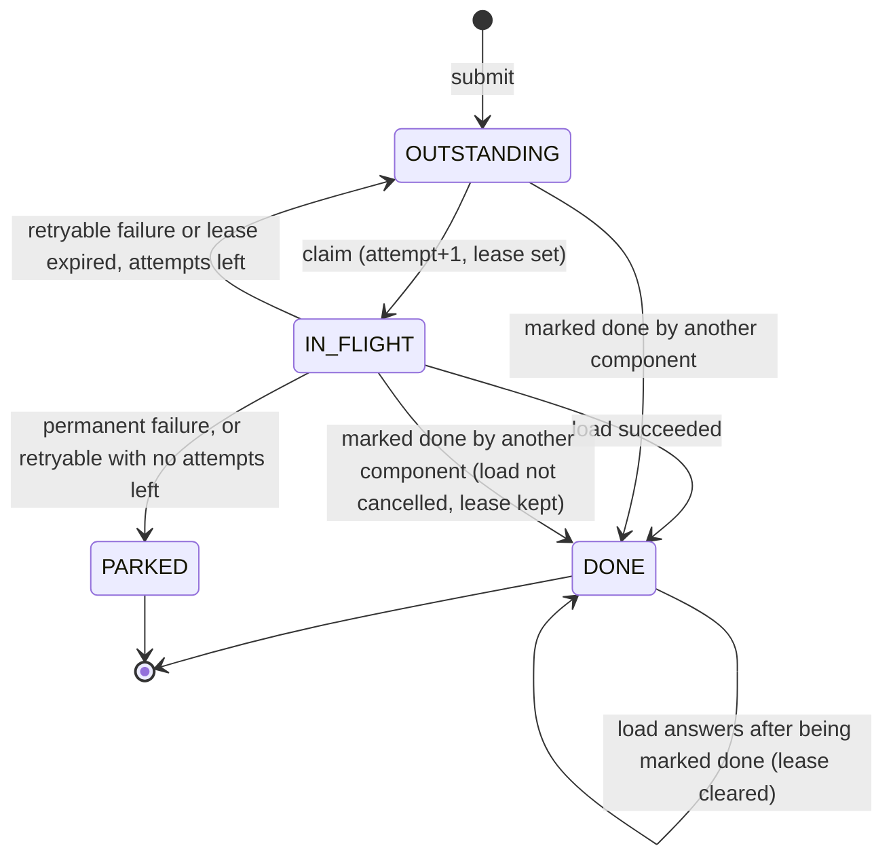

# Data Model: Template-Publish Fan-out Worker

**Feature**: `002-fanout-worker` | **Date**: 2026-10-14 | **Spec**: [spec.md](spec.md) |
**Decisions**: [research.md](research.md)

## Work item (aggregate, `domain/model`)

One engagement to load. The aggregate owns every state change; services only call its methods
and save the result.

| Field | Type (domain) | Rule |
|---|---|---|
| `id` | `WorkItemId` (UUID) | Assigned at submit |
| `engagementId` | `EngagementId` | Opaque, non-blank, ≤ 64 chars |
| `firmId` | `FirmId` | Opaque, non-blank, ≤ 64 chars |
| `reason` | `Reason` enum: `ACTIVATION`, `PUBLISH`, `SWEEP` | Recorded only; never affects order (FR-006) |
| `state` | `WorkItemState` enum: `OUTSTANDING`, `IN_FLIGHT`, `DONE`, `PARKED` | Exactly one (FR-002) |
| `attempt` | `Attempt` (count ≥ 0) | Incremented on each claim |
| `addedAt` | `Instant` | Order within a firm: oldest first |
| `nextAttemptAt` | `Instant` | Outstanding items are due when `nextAttemptAt ≤ now` |
| `leaseUntil` | `Instant` or null | Set at claim to `claim time + load timeout + grace`; cleared when the load answers or the lease expires. Kept when the item is marked done during its load. A slot is taken while `leaseUntil > now`, whatever the state |
| `lastError` | error code or null | `TIMEOUT`, `HTTP_503`, `CONNECT`, …; never a response body |
| `version` | `long` | Optimistic concurrency; every save is conditional on it |

Value objects (`domain/model`): `WorkItemId`, `FirmId`, `EngagementId`, `Attempt`. Each validates
in its constructor and is a Java `record`.

`LoadOutcome` (`domain/model`), the neutral result of one load as the HTTP adapter saw it:
`Answered(status)`, `TimedOut` or `ConnectFailed`. `isSuccess()` is true only for `Answered` with
a 2xx status; `errorCode()` is `HTTP_<status>`, `TIMEOUT` or `CONNECT`. Whether a failure is
retryable or permanent is decided by `RetryPolicy`, not by the outcome or the adapter (research §4).

Persistence goes through `WorkItem.Snapshot`, a plain record of all fields:
`workItem.snapshot()` and `WorkItem.restore(snapshot)`. The persistence adapter maps its row type
to and from the snapshot with MapStruct, so the aggregate needs no public all-fields constructor
and no setters.

## State transitions

| Method | From | To | Effect | Event |
|---|---|---|---|---|
| `submit(engagement, firm, reason, now)` | none | `OUTSTANDING` | `attempt = 0`, `nextAttemptAt = addedAt = now` | |
| `claim(now, leaseDuration)` | `OUTSTANDING`, due | `IN_FLIGHT` | `attempt + 1`, `leaseUntil = now + leaseDuration` | |
| `answer(attempt, outcome with isSuccess(), now, retryPolicy)` | `IN_FLIGHT`, same attempt | `DONE` | lease cleared | `WorkItemCompleted` |
| `answer(attempt, any other outcome, now, retryPolicy)` | `IN_FLIGHT`, same attempt | `OUTSTANDING` or `PARKED` | lease cleared; `RetryPolicy` classifies retryable or permanent and decides retry or park; `lastError = errorCode()` | `WorkItemParked` if parked |
| `answer(attempt, any outcome, now, retryPolicy)` | `DONE` with `leaseUntil` set, same attempt | `DONE` | lease cleared: the slot is released | |
| `answer(attempt, any outcome, now, retryPolicy)` | anything else (lease expired and the item moved on) | unchanged | ignored; the expired lease no longer counts | |
| `expireLease(now, retryPolicy)` | `IN_FLIGHT`, `leaseUntil ≤ now` | `OUTSTANDING` or `PARKED` | lease cleared; same as a failed answer with `TIMEOUT` | `WorkItemParked` if parked |
| `markDone(now)` | `OUTSTANDING` | `DONE` | | `WorkItemCompleted` |
| `markDone(now)` | `IN_FLIGHT` | `DONE` | lease **kept**: the load is still running at EMS and its slot stays counted until it answers or the lease expires (FR-004, FR-005) | `WorkItemCompleted` |

`answer` never throws: an answer that matches no current load is ignored. Any other call in a
state not listed throws `InvalidTransitionException` (`domain/exception`). `DONE` and `PARKED` are
terminal: re-adding the engagement creates a new item (FR-012). Events are collected in the
aggregate and drained by the service after a successful save (`pullEvents()`).

**Late answers**: the answer carries the attempt it was claimed with, and the aggregate decides
(table above). "Marked done while in flight" stays done (spec edge case), and its slot is released
only when the load answers or its lease expires. The service reloads the item and saves
conditionally on the version it just read; on a conflict (for example `markDone` in between) it
reloads and applies the answer again, at most 3 times; then it logs the conflict (opaque ids) and
leaves the item, whose lease expires and is handled by step 1 of the cycle (research §5).

## Policies (`domain/policy`)

| Policy | Input | Output |
|---|---|---|
| `ConcurrencyLimits(global, perFirm)` | in-flight counts (total and per firm) | free global slots; free slots for a firm. Validates `0 ≤ perFirm ≤ global` |
| `FairnessPolicy` | free slots, limits, in-flight per firm, firms with due work and their oldest `addedAt` | slots per firm (research §3) |
| `RetryPolicy(maxAttempts, baseDelay, maxDelay)` | attempt, failure kind, now | retry at an instant, or park (research §4) |

## Domain events (`domain/event`)

| Event | Fields | Published as |
|---|---|---|
| `WorkItemCompleted` | work item id, engagement id, firm id, attempt, at | one log line, opaque ids only |
| `WorkItemParked` | work item id, engagement id, firm id, attempt, error code, at | one log line, opaque ids only |

## Tables (Flyway, `adapter/out/persistence`)

### `work_item` (`V1__work_item.sql`)

| Column | Type | Constraint |
|---|---|---|
| `id` | `uuid` | primary key |
| `engagement_id` | `varchar(64)` | not null |
| `firm_id` | `varchar(64)` | not null |
| `reason` | `varchar(16)` | not null, check in the three reasons |
| `state` | `varchar(16)` | not null, check in the four states |
| `attempt` | `integer` | not null, `>= 0` |
| `added_at` | `timestamptz` | not null |
| `next_attempt_at` | `timestamptz` | not null |
| `lease_until` | `timestamptz` | null; checks: not null when `state = 'IN_FLIGHT'`; null when `state in ('OUTSTANDING','PARKED')`; either when `DONE` (set while a load marked done is still running) |
| `last_error` | `varchar(32)` | null |
| `version` | `bigint` | not null |
| `updated_at` | `timestamptz` | not null |

| Index | Definition | Serves |
|---|---|---|
| `ux_work_item_open_engagement` | unique `(engagement_id)` where `state in ('OUTSTANDING','IN_FLIGHT')` | FR-013, SC-004 |
| `ix_work_item_due` | `(firm_id, added_at)` where `state = 'OUTSTANDING'` | fairness query and oldest-first per firm |
| `ix_work_item_lease` | `(lease_until)` where `lease_until is not null` | in-flight count (`lease_until > now`, any state) and expiry |

### `capacity_settings` (`V2__capacity_settings.sql`)

| Column | Type | Constraint |
|---|---|---|
| `id` | `smallint` | primary key, check `id = 1` (one row) |
| `global_limit` | `integer` | not null, `>= 0` |
| `per_firm_limit` | `integer` | not null, `>= 0`, `<= global_limit` |
| `updated_at` | `timestamptz` | not null |

Inserted from configuration at startup only if missing; changed by the operator with `UPDATE`
(research §2). A limit of 0 pauses new loads (spec edge case).

### Local seed (`db/seed-local/V100__seed_work_items.sql`, `local` profile only)

A few outstanding items for three firms of different sizes, including one engagement id that
WireMock answers with 404 (parked at once) and one that answers 503 twice and then succeeds.

## Retention

Terminal rows (`DONE`, `PARKED`) are kept. A full backfill adds one row per engagement in the
region (~800,000 across all regions [P]), and each sweep adds more; a purge job is out of scope and
noted for operations.
